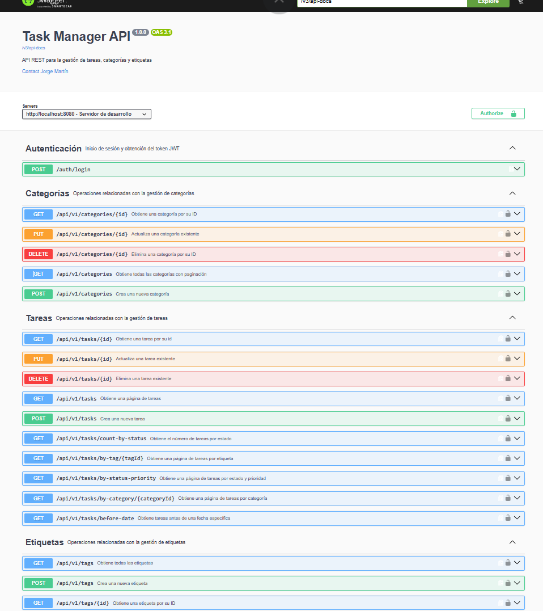
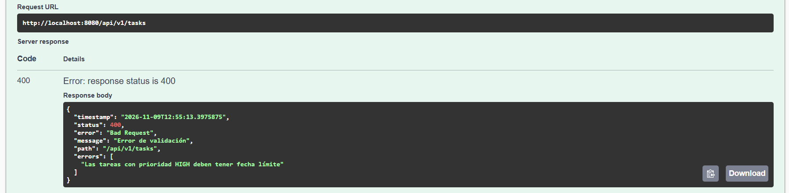
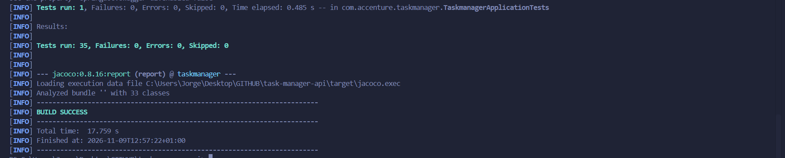

# Task Manager API


API REST de **gestión de tareas** con categorías y etiquetas, desarrollada con **Spring Boot**.

Es el proyecto de prácticas del bootcamp **Back-End Java con GenAI** (Accenture · Universidad San Pablo CEU). Se construyó de forma **incremental, en 12 entregas**: cada una añadía una capa o una funcionalidad sobre la anterior. El proyecto final del bootcamp, que aplica todo esto desde cero, es [library-management-api](https://github.com/JorgeMPM/library-management-api).

### Cómo evolucionó

| Entrega | Qué se añadió |
|---|---|
| 00–02 | Entorno, controller REST y capa de servicio (interfaz + implementación) |
| 03–04 | Entidades JPA, relaciones y Spring Data JPA: consultas, paginación, ordenación y transacciones |
| 05–06 | DTOs con mappers y Bean Validation, incluida una validación personalizada |
| 07–08 | Manejo global de errores y documentación OpenAPI (Swagger UI) |
| 09 | Tests unitarios, de controller, de repositorio y de integración |
| 10–11 | Seguridad con JWT y despliegue con Docker |

### Tecnologías

| Área | Tecnología |
|---|---|
| Lenguaje | Java 17 |
| Framework | Spring Boot 4.1.1 (Web MVC, Data JPA, Validation, Security) |
| Base de datos | MySQL 8 · H2 en memoria (tests y perfil Docker) |
| Seguridad | Spring Security + JWT (jjwt) |
| Documentación | springdoc-openapi (Swagger UI) |
| Tests | JUnit 5, Mockito, MockMvc, `@DataJpaTest`, JaCoCo |
| Otros | Maven, Docker |

### Capturas

**Documentación OpenAPI (Swagger UI)**: todos los endpoints, protegidos con JWT salvo el login.



**Regla de negocio**: una tarea de prioridad `HIGH` sin fecha límite se rechaza con un 400 que explica el motivo (validación personalizada `@RequiereFechaLimite`).



**Tests**: 35 tests unitarios, de controller, de repositorio y de integración.



---

## Funcionalidades

- **Tareas** con título, descripción, estado (`PENDING`, `IN_PROGRESS`, `DONE`), prioridad (`LOW`, `MEDIUM`, `HIGH`), fecha límite y fecha de creación automática (`@PrePersist`).
- **Categorías** (una por tarea, `@ManyToOne`) y **etiquetas** (varias por tarea, `@ManyToMany`).
- **Consultas**: tareas por categoría, por etiqueta, por estado y prioridad, anteriores a una fecha y recuento por estado.
- **Paginación y ordenación** en los listados de tareas y categorías (10 por página; las tareas, de la más reciente a la más antigua, y las categorías, por nombre).
- **Validaciones**: campos obligatorios, longitudes, fecha límite futura y una regla propia, `@RequiereFechaLimite`: una tarea de prioridad `HIGH` debe tener fecha límite.
- **Manejo global de errores** con una estructura de respuesta común (`ErrorResponse`).
- **Seguridad stateless con JWT**: todas las rutas exigen token salvo el login y Swagger.

---

## Requisitos previos

| Herramienta | Versión |
|---|---|
| Java (JDK) | 17 o superior |
| Maven | 3.9 o superior (también vale el wrapper incluido, `./mvnw`) |
| MySQL | 8.0 o superior (no hace falta si se usa Docker) |

---

## Puesta en marcha

### 1. Crear la base de datos

El script `db/schema.sql` crea las tablas `category`, `tag`, `task` y `task_tag`. Primero se crea la base de datos y después se ejecuta el script dentro de ella:

```bash
mysql -u root -p -e "CREATE DATABASE IF NOT EXISTS taskmanager"
mysql -u root -p taskmanager < db/schema.sql
```

También se puede ejecutar desde MySQL Workbench.

### 2. Configurar las credenciales (variables de entorno)

Las credenciales **no están en el código**: se leen de variables de entorno.

| Variable | Para qué | Por defecto |
|---|---|---|
| `DB_PASSWORD` | Contraseña de MySQL | *(vacía)* |
| `DB_USERNAME` | Usuario de MySQL | `root` |
| `DB_URL` | URL de conexión | `jdbc:mysql://localhost:3306/taskmanager` |
| `JWT_SECRET` | Clave de firma de los tokens (mínimo 32 caracteres) | clave de desarrollo, **no usar en producción** |

```powershell
# PowerShell (Windows)
$env:DB_PASSWORD="tu_contraseña"
```

```bash
# Bash (Linux / macOS / Git Bash)
export DB_PASSWORD=tu_contraseña
```

### 3. Arrancar la aplicación

```bash
./mvnw spring-boot:run
```

La API queda disponible en `http://localhost:8080`.

### 4. Ejecutar los tests

```bash
./mvnw test
```

Los tests usan H2 en memoria: no necesitan MySQL.

---

## Documentación de la API (Swagger UI)

**http://localhost:8080/swagger-ui.html**

1. Ejecutar `POST /auth/login` con usuario `admin` y contraseña `admin123`.
2. Copiar el `token` de la respuesta.
3. Pulsar **Authorize** y pegar el token.

Las credenciales son de ejemplo y están fijas en `AuthController`; en un proyecto real vendrían de una base de datos de usuarios.

---

## Endpoints

Todos requieren `Authorization: Bearer <token>`, salvo `POST /auth/login`.

| Método | URL | Descripción |
|---|---|---|
| POST | `/auth/login` | Iniciar sesión y obtener el token JWT |
| GET | `/api/v1/tasks` | Listar tareas (paginado y ordenado) |
| GET | `/api/v1/tasks/{id}` | Obtener una tarea |
| POST | `/api/v1/tasks` | Crear una tarea |
| PUT | `/api/v1/tasks/{id}` | Actualizar una tarea |
| DELETE | `/api/v1/tasks/{id}` | Eliminar una tarea |
| GET | `/api/v1/tasks/by-category/{categoryId}` | Tareas de una categoría (paginado) |
| GET | `/api/v1/tasks/by-tag/{tagId}` | Tareas con una etiqueta (paginado) |
| GET | `/api/v1/tasks/by-status-priority?status=&priority=` | Tareas por estado y prioridad (paginado) |
| GET | `/api/v1/tasks/before-date?date=` | Tareas con fecha límite anterior a una fecha |
| GET | `/api/v1/tasks/count-by-status?status=` | Número de tareas en un estado |
| GET | `/api/v1/categories` | Listar categorías (paginado) |
| GET | `/api/v1/categories/{id}` | Obtener una categoría |
| POST | `/api/v1/categories` | Crear una categoría |
| PUT | `/api/v1/categories/{id}` | Actualizar una categoría |
| DELETE | `/api/v1/categories/{id}` | Eliminar una categoría |
| GET | `/api/v1/tags` | Listar etiquetas |
| GET | `/api/v1/tags/{id}` | Obtener una etiqueta |
| POST | `/api/v1/tags` | Crear una etiqueta |

Los listados paginados aceptan `page` (desde 0), `size` (10 por defecto) y `sort` (`campo,dirección`). Por defecto, las tareas se ordenan por `createdAt,desc` y las categorías por `name,asc`.

---

## Tests

35 tests con JUnit 5 y el patrón Given / When / Then:

| Clase | Tests | Tipo |
|---|---|---|
| `TaskServiceImplTest` | 10 | Unitarios del service, con Mockito |
| `TaskControllerTest` | 10 | Capa web con `@WebMvcTest` y MockMvc |
| `TaskRepositoryTest` | 9 | Consultas con `@DataJpaTest` sobre H2 |
| `TaskIntegrationTest` | 5 | Integración: aplicación completa en un puerto aleatorio, con `TestRestTemplate` y H2 |
| `TaskmanagerApplicationTests` | 1 | Arranque del contexto |

La cobertura se mide con **JaCoCo**: tras `./mvnw test`, el informe queda en `target/site/jacoco/index.html`.

---

## Docker

`Dockerfile` multi-stage: Maven con Java 17 para compilar y `eclipse-temurin:17-jre-alpine` para ejecutar. Dentro del contenedor se activa el perfil `docker`, que usa **H2 en memoria**, así que no necesita MySQL (la base de datos arranca vacía).

```bash
docker build -t taskmanager:1.0 .
docker run -p 8080:8080 taskmanager:1.0
```

---

## Mejoras futuras

- **Usuarios en base de datos** con roles, en lugar de las credenciales fijas del login.
- **Ampliar los tests de la capa de servicio**: `CategoryServiceImpl` y `TagServiceImpl` aún no tienen tests unitarios propios.
- **Completar el CRUD de etiquetas** (actualizar y eliminar).
- **Relaciones unidireccionales y sin `cascade`**, como en el proyecto final, para simplificar el modelo.
- **Docker Compose** con un contenedor de MySQL para que los datos persistan.

---

## Autor

**Jorge Martín Pérez Moreno** · Desarrollador Software Junior

- LinkedIn: [jorge-martin-perez-moreno](https://www.linkedin.com/in/jorge-martin-perez-moreno)
- Portfolio: [jorge-martin-dev.netlify.app](https://jorge-martin-dev.netlify.app/)
- Email: jorgemartinpm@gmail.com
